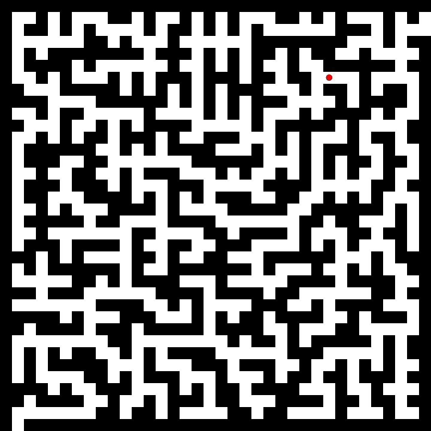

Mazes
======
Install & USAGE
======
There are mulitple dependencies:

  For C++ it uses NCurses library - make sure this is installed prior to
  running make.

  To build, simply navigate to the `C++` directory and run:

    `$ make`

  And invoke to run:

    `$ .\maze`

  With Python running correctly depends on `git clone` into your `HOME`
  directory.

  Then call `python $path-to-Prim.py` (or any other path-finding algorithm
  maze).

C++
======

The `C++` maze is wip at this point.  Making the adjustment to using `ncurses`
for the maze generator and using `C++` itself.

Python
======
Randomized maze generator with pygames

There are three mazes you can run, first `cd /path/of/pymaze` then:

    python shape_maze.py

to run the shape maze or:

    python DFS_maze.py

for the depth first search algorithm generated maze or:

    python prims_maze.py

to run the prims algorithm generated maze.

#### Description:

The depth first search or **DFS** maze will randomly chose a path direction 
while there are still "unexplored" grid coordinates left.  If the path 
direction is blocked by intersections or the grid edge, the path direction 
will back track to the last unblocked and unexplored coordinate.  This will 
repeat until all coordinates are "explored".

The **prims** maze starts by creating a matrix of coordinates and assigning a
random weight to each node. Then a random coordinate from the matrix is selected 
to give the maze a starting point to expand from.  Once that position is 
established, all edges adjacent to that position are added to the frontier array. 
Since every coordinate has been assigned a random weight, the next position is 
determined by the minimum weight in the frontier array.  These steps are 
repeated until there are no more frontier edges. 

The solution path finder uses an **A star** search algorithm to find the optimal 
path to solve the maze.

#### Maze Navigation:

You start at the bottom left corner and use the arrow keys to move, 
finishing at the top right.

Use the `s` key to show the maze solution path.
